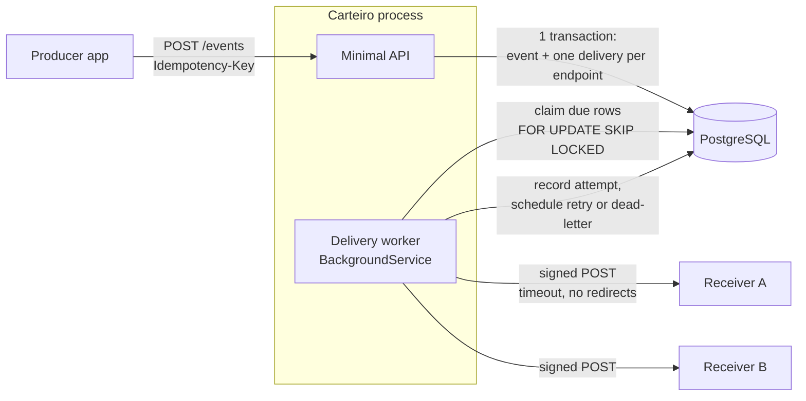
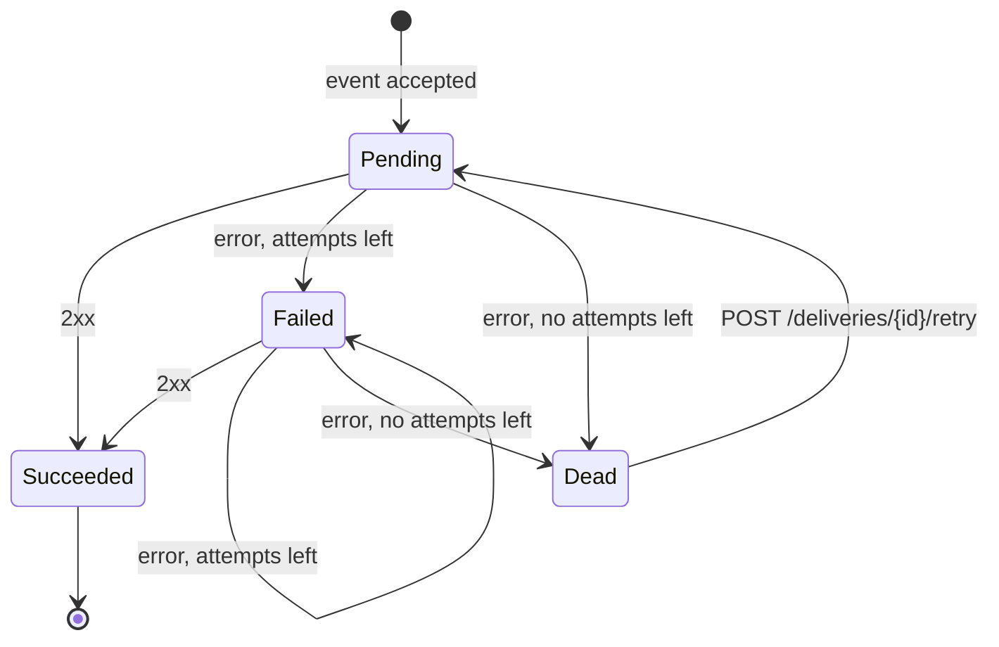

# Carteiro

[](https://github.com/JoseOtavioJunqueira/carteiro/actions/workflows/ci.yml)
[](LICENSE)

Carteiro ("mail carrier" in Portuguese) is a small, self-hosted webhook delivery service written in
C# on .NET 9 with PostgreSQL. Your application POSTs an event to it once; Carteiro takes care of
fanning it out to every subscribed endpoint, signing each request, retrying with backoff when
receivers fail, and parking deliveries it could not complete in a dead-letter state where you can
inspect and retry them.

It is a learning and portfolio project, not a product: it has not been used in production. The
goal was to get the reliability parts right and to be able to show, with tests, that they are.

## Why not just call `HttpClient.PostAsync`?

The naive version of "send a webhook" is an HTTP call inside the request that caused the event:

```csharp
await db.SaveChangesAsync();                      // order saved
await http.PostAsJsonAsync(customerUrl, order);   // webhook sent... hopefully
```

That breaks in several ways:

- **The receiver is down or slow.** Your request now fails or hangs because somebody else's server
  is having a bad day. If you swallow the error, the event is gone.
- **Your process dies between the two lines.** The order is saved, the webhook is never sent, and
  nothing remembers that it should have been.
- **Retries without care cause damage.** Retrying in a tight loop hammers a receiver that is
  already struggling; retrying on several instances at once sends duplicates.
- **Receivers can't trust the request.** Without a signature anyone who learns the URL can post
  fake events to it.
- **The URL is user input.** A customer can register `http://169.254.169.254/` and use your
  server to read your cloud metadata (SSRF).

Carteiro moves all of this out of the producer: accepting an event is a single fast database
transaction, and delivery happens in the background with retries, signatures and history.

## How it works



1. `POST /events` validates the event, finds the enabled endpoints subscribed to its type and
   inserts the event plus one `deliveries` row per endpoint **in one transaction**. If the request
   returns 201, the deliveries exist. ([ADR 3](docs/adr/0003-fan-out-in-the-ingest-transaction.md))
2. The worker polls for due deliveries and claims a batch with `SELECT ... FOR UPDATE SKIP LOCKED`,
   setting a short lease (`locked_until`) and a `lock_token`. Several worker instances can run
   against the same database without taking the same row. ([ADR 1](docs/adr/0001-postgres-as-the-delivery-queue.md))
3. Each claimed delivery is sent with **no database transaction open**: signed `POST`, per-request
   timeout, any non-2xx is a failure, redirects are not followed.
4. The result is recorded in a second short transaction, which first checks that the worker still
   owns the lease (fencing token). The attempt is appended to `delivery_attempts`, and the
   delivery becomes `Succeeded`, `Failed` (with a new `next_attempt_at`) or `Dead`.
   ([ADR 4](docs/adr/0004-leases-and-fencing-for-claimed-deliveries.md))

### Delivery states



The state machine lives in [`Delivery`](src/Carteiro/Domain/Delivery.cs) and is unit tested
without a database.

## Quickstart

Requirements: Docker with Compose. The compose file starts PostgreSQL, Carteiro (port 8080) and a
sample receiver (port 8081) that verifies signatures and can be told to fail. If those ports are
taken, set `CARTEIRO_PORT` / `RECEIVER_PORT` (see `.env.example`).

```bash
docker compose up --build
```

The demo shortens the retry schedule (4 attempts, 5 s base delay, 20 s cap) so you can watch a
delivery die in about half a minute. Every output below was captured from a real run; ids and
timestamps will differ on yours.

**Register an endpoint.** The secret is optional (one is generated if omitted); here it is set so
the sample receiver knows it. It is returned only on creation.

```bash
curl -s -X POST localhost:8080/endpoints \
  -H "X-Api-Key: dev-api-key" -H "Content-Type: application/json" \
  -d '{"url":"http://receiver:8080/hooks","eventTypes":["order.created"],"secret":"whsec_demo_secret_change_me","description":"demo receiver"}'
```
```json
{"id":"01a1e9b0-582e-7d73-a382-7ac59dfc580b","url":"http://receiver:8080/hooks","description":"demo receiver","eventTypes":["order.created"],"enabled":true,"secret":"whsec_demo_secret_change_me","createdAt":"2026-11-17T13:26:50.6706165+00:00"}
```

**Publish an event.**

```bash
curl -s -X POST localhost:8080/events \
  -H "X-Api-Key: dev-api-key" -H "Content-Type: application/json" \
  -H "Idempotency-Key: order-1001-created" \
  -d '{"type":"order.created","payload":{"orderId":1001,"total":59.9}}'
```
```json
{"id":"01a1e9b0-59f5-7a7f-9dd2-3c25427942c6","type":"order.created","payload":{"orderId":1001,"total":59.9},"idempotencyKey":"order-1001-created","createdAt":"2026-11-17T13:26:51.1258119+00:00","deliveries":[{"id":"01a1e9b0-59f5-755b-8d1a-505e0c475bd8","endpointId":"01a1e9b0-582e-7d73-a382-7ac59dfc580b","status":"Pending","attemptCount":0}]}
```

**See it delivered.** A moment later:

```bash
curl -s localhost:8080/deliveries/01a1e9b0-59f5-755b-8d1a-505e0c475bd8 -H "X-Api-Key: dev-api-key"
```
```json
{"attempts":[{"attemptNumber":1,"succeeded":true,"statusCode":200,"durationMs":206,"error":null,"attemptedAt":"2026-11-17T13:26:51.950318+00:00"}],"id":"01a1e9b0-59f5-755b-8d1a-505e0c475bd8","eventId":"01a1e9b0-59f5-7a7f-9dd2-3c25427942c6","endpointId":"01a1e9b0-582e-7d73-a382-7ac59dfc580b","status":"Succeeded","attemptCount":1,"nextAttemptAt":null,"lastError":null,"createdAt":"2026-11-17T13:26:51.125811+00:00","completedAt":"2026-11-17T13:26:51.950318+00:00"}
```

The receiver checked the signature independently:

```bash
curl -s localhost:8081/received
```
```json
[{"at":"2026-11-17T13:26:51.9117647+00:00","deliveryId":"01a1e9b0-59f5-755b-8d1a-505e0c475bd8","attempt":"1","signatureValid":true,"body":"{\"orderId\":1001,\"total\":59.9}"}]
```

**Idempotency.** Sending the same request again returns the same event with `200` and
`Idempotent-Replayed: true`; no new deliveries are created. Reusing the key with a different
payload is refused:

```text
HTTP/1.1 200 OK
Idempotent-Replayed: true
{"id":"01a1e9b0-59f5-7a7f-9dd2-3c25427942c6", ... "deliveries":[{"id":"01a1e9b0-59f5-755b-8d1a-505e0c475bd8", ... "status":"Succeeded","attemptCount":1}]}
```
```json
{"title":"Idempotency key reuse","status":422,"detail":"This Idempotency-Key was already used for event 01a1e9b0-59f5-7a7f-9dd2-3c25427942c6 with a different type or payload."}
```

**Watch a failing delivery retry and go dead.** Make the receiver answer 500, then publish:

```bash
curl -s -X PUT localhost:8081/mode/500
curl -s -X POST localhost:8080/events \
  -H "X-Api-Key: dev-api-key" -H "Content-Type: application/json" \
  -H "Idempotency-Key: order-1002-created" \
  -d '{"type":"order.created","payload":{"orderId":1002,"total":10.0}}'
```

Polling the delivery every 3 seconds showed:

```text
t+3s  "status":"Failed","attemptCount":1
t+6s  "status":"Failed","attemptCount":2
t+15s "status":"Failed","attemptCount":3
t+33s "status":"Dead","attemptCount":4
```

The worker logs each step. These lines are from a second run of the same commands, so the ids
differ from the ones above:

```text
Delivery 01a1e9b3-8fce-7661-88ec-6ba9ef7409f0 failed on attempt 1: Receiver responded with HTTP 500. Next attempt at 11/17/2026 13:30:25 +00:00
Delivery 01a1e9b3-8fce-7661-88ec-6ba9ef7409f0 failed on attempt 2: Receiver responded with HTTP 500. Next attempt at 11/17/2026 13:30:35 +00:00
Delivery 01a1e9b3-8fce-7661-88ec-6ba9ef7409f0 failed on attempt 3: Receiver responded with HTTP 500. Next attempt at 11/17/2026 13:30:55 +00:00
Delivery 01a1e9b3-8fce-7661-88ec-6ba9ef7409f0 is dead after 4 attempts: Receiver responded with HTTP 500.
Delivery 01a1e9b3-8fce-7661-88ec-6ba9ef7409f0 succeeded on attempt 5 with HTTP 200 in 2 ms
```

The last line is the manual redrive described below. Dead deliveries can be listed with `GET /deliveries?status=Dead`.

**Fix the receiver and redrive.**

```bash
curl -s -X PUT localhost:8081/mode/200
curl -s -X POST localhost:8080/deliveries/01a1e9b0-888a-7e4c-afec-0739c3e03991/retry -H "X-Api-Key: dev-api-key"
```
```json
{"id":"01a1e9b0-888a-7e4c-afec-0739c3e03991", ... "status":"Pending","attemptCount":4, ...}
```

A few seconds later the delivery is `Succeeded` with `attemptCount` 5. Retrying a delivery that is
not dead returns `409 Conflict`.

```bash
docker compose down -v
```

## API

All routes except health and OpenAPI require `X-Api-Key`. The OpenAPI document is served at
`/openapi/v1.json`.

| Method | Route | |
|---|---|---|
| `POST` | `/endpoints` | Register an endpoint (`url`, `eventTypes`, optional `secret`, `description`). `"*"` subscribes to every type. |
| `GET` | `/endpoints`, `/endpoints/{id}` | List / get. The secret is never returned after creation. |
| `PATCH` | `/endpoints/{id}` | Change `url`, `eventTypes`, `description`, `enabled`. Enabling resets the failure streak. |
| `DELETE` | `/endpoints/{id}` | Delete, with its deliveries and attempts. |
| `POST` | `/events` | Publish. Optional `Idempotency-Key` header. Payload must be a JSON object, max 256 KB. |
| `GET` | `/events/{id}` | Event with its deliveries. |
| `GET` | `/deliveries` | Filter by `status`, `endpointId`, `eventId`; page with `limit` (max 200) and `offset`. |
| `GET` | `/deliveries/{id}` | Delivery with every attempt (status code, duration, error). |
| `POST` | `/deliveries/{id}/retry` | Re-queue a `Dead` delivery for one more attempt. |
| `GET` | `/health/live`, `/health/ready` | Liveness; readiness also checks the database. |

Errors use RFC 7807 problem details.

## Verifying webhooks (for receivers)

Every request carries:

| Header | |
|---|---|
| `Carteiro-Delivery-Id` | Stable across retries of the same delivery. **Use it to deduplicate.** |
| `Carteiro-Event-Id`, `Carteiro-Event-Type` | The event. |
| `Carteiro-Attempt` | 1-based attempt number. |
| `Carteiro-Timestamp` | Unix seconds when the request was signed. |
| `Carteiro-Signature` | `v1=` + hex HMAC-SHA256 of `{timestamp}.{raw body}` with the endpoint secret. |

To verify:

1. Read the **raw** request body. Do not parse and re-serialize the JSON first.
2. Reject the request if `Carteiro-Timestamp` is more than a few minutes from your clock. The
   timestamp is part of the signed content, so an attacker who captured a request can neither
   replay it later nor change the timestamp without invalidating the signature.
3. Compute `HMAC-SHA256(secret, timestamp + "." + body)`, hex encode it, and compare with the
   value after `v1=` using a constant-time comparison.
4. Answer 2xx quickly and do the work asynchronously. Anything else, or no answer within the
   timeout (10 s by default), counts as a failure and will be retried.

```csharp
var signed = $"{timestamp}.{rawBody}";
var expected = HMACSHA256.HashData(Encoding.UTF8.GetBytes(secret), Encoding.UTF8.GetBytes(signed));
var provided = Convert.FromHexString(signatureHeader["v1=".Length..]);
var valid = CryptographicOperations.FixedTimeEquals(expected, provided);
```

The [sample receiver](samples/Receiver/Program.cs) is a complete example. You can reproduce a
signature from the shell with
`printf '%s' "$TS.$BODY" | openssl dgst -sha256 -hmac "$SECRET"`; a unit test pins Carteiro's
output to exactly that.

## Reliability details

**Retries.** Exponential backoff with jitter: after the n-th failed attempt the wait is drawn
uniformly from `[c/2, c)` where `c = min(MaxDelay, BaseDelay * 2^(n-1))`. With the defaults
(10 s base, 1 h cap, 10 attempts) the nine waits have ceilings of 10 s, 20 s, 40 s ... 2560 s, which
add up to about 85 minutes; with jitter a delivery is retried for roughly 45 to 85 minutes before
it is dead-lettered. Raise `MaxAttempts` (the 1 h cap kicks in from the 10th wait) for a longer window. Jitter keeps a receiver that
comes back after an outage from being hit by every queued delivery at the same instant. The policy
is a pure function ([`RetryPolicy`](src/Carteiro/Dispatch/RetryPolicy.cs)) that takes the random
sample as an argument, so tests check it with fixed inputs.

**Auto-disable.** Every failed attempt increments the endpoint's `consecutive_failures` (atomically
in SQL, so concurrent workers don't lose updates); any success resets it to zero. When it reaches
`EndpointFailureThreshold` (20 by default; 0 turns this off) the endpoint is disabled with a
reason. While disabled:

- new events are not fanned out to it;
- its pending retries are parked: the worker skips them, and they do not burn attempts.

`PATCH /endpoints/{id}` with `{"enabled": true}` re-enables it, resets the streak, and the parked
deliveries resume. This is a circuit breaker without the automatic half-open state: an endpoint
that has failed twenty times in a row needs a human (or the endpoint owner) to say it is fixed.

**SSRF protection.** By default Carteiro refuses to deliver to loopback, private (RFC 1918),
link-local (including `169.254.169.254`), carrier-grade NAT, multicast, reserved and the
corresponding IPv6 ranges. It checks in two places:

- when an endpoint is registered or its URL changed, URLs that are obviously internal
  (`localhost`, literal private IPs, including tricks like `http://2130706433/`) are rejected with
  a 400;
- on every delivery, inside the socket connect callback, **after DNS resolution**: if any address
  the host resolves to is not public, the attempt fails with "Destination blocked". Checking the
  resolved address at connect time is what defends against DNS rebinding and names that point at
  internal IPs.

Redirects are not followed and system proxies are ignored, since either would bypass the check.
Set `Carteiro:Delivery:AllowPrivateNetworks=true` only for local development or when every
receiver is on a network you trust. The docker compose demo sets it because the receiver
container has a private address.

**Payload integrity.** The payload is stored as `text`, exactly as the producer sent it (not
`jsonb`, which would normalize whitespace and key order), so the bytes that get signed are the
bytes the producer sent.

## Design decisions and trade-offs

**At-least-once, not exactly-once.** If the connection drops after the receiver handled a request
but before Carteiro read the response, there is no way to know whether it was handled. Carteiro
retries, so receivers may see a delivery twice and must deduplicate on `Carteiro-Delivery-Id`.
Ordering between events is not guaranteed either. See [ADR 2](docs/adr/0002-at-least-once-delivery.md).

**PostgreSQL with `SKIP LOCKED` instead of a broker.** The deliveries table already has to exist
for history and the API. Making it the queue means one system to run and no dual write between a
database and a broker. The cost is polling (one indexed query per second per idle worker) and a
throughput ceiling set by one PostgreSQL primary, which is far above what waiting on third-party
HTTP servers allows anyway. One thing I checked rather than assumed: the `locked_until` filter
alone is **not** enough. With `FOR UPDATE SKIP LOCKED` removed, both tests in
`ConcurrentWorkerTests` failed in each of three runs (e.g. 360 sends for 300 deliveries).
See [ADR 1](docs/adr/0001-postgres-as-the-delivery-queue.md).

**Leases instead of long transactions.** Holding a row lock for the length of an HTTP call would
pin a connection per in-flight request. Claims commit immediately and use a lease plus a fencing
token instead. See [ADR 4](docs/adr/0004-leases-and-fencing-for-claimed-deliveries.md).

**Fan-out at ingest.** Deliveries are created in the same transaction as the event, which
guarantees they exist but makes ingest cost proportional to the number of subscribers, and fixes
the subscriber set at publish time. See [ADR 3](docs/adr/0003-fan-out-in-the-ingest-transaction.md).

**Worker in the same process as the API.** Simpler to run. `Carteiro:Worker:Enabled=false` turns
the worker off, so API-only and worker-only instances are possible from the same image.

### What is missing / what I would do next

- **Secret rotation.** One secret per endpoint. Rotation would mean signing with two secrets for a
  while (multiple `v1=` values in the header) so receivers can switch over.
- **Secrets at rest.** Endpoint secrets are stored in plain text in the database. They have to be
  recoverable to sign, so hashing is not an option; encrypting them with a key from a KMS or
  ASP.NET Data Protection would be.
- **Multi-tenancy and real auth.** A single shared set of API keys. A real service would scope
  endpoints and events per tenant and use per-tenant credentials.
- **Retention.** Events, deliveries and attempts are kept forever. A periodic job (or table
  partitioning by month) would delete or archive old history.
- **Per-endpoint rate limiting and concurrency limits**, so one busy endpoint cannot take a whole
  batch.
- **Ordering per endpoint**, for receivers that need it, at the cost of head-of-line blocking.
- **Metrics export.** Metrics are published with `System.Diagnostics.Metrics` (meter `Carteiro`:
  `carteiro.delivery.attempts`, `carteiro.delivery.attempt.duration`,
  `carteiro.delivery.dead_lettered`, `carteiro.endpoint.auto_disabled`) but nothing exports them
  yet; `dotnet-counters` with `--counters Carteiro` can read them from a running process.
  Wiring up the OpenTelemetry exporter is the next step.
- **`LISTEN/NOTIFY`** to wake workers immediately instead of polling.
- **Load testing.** I have not measured throughput, so this README makes no performance claims.

## Configuration

Everything lives under the `Carteiro` section (`appsettings.json`, or environment variables such
as `Carteiro__Delivery__MaxAttempts`). The connection string is `ConnectionStrings:Carteiro`.

| Setting | Default | |
|---|---|---|
| `ApiKeys` | (none, required) | Accepted `X-Api-Key` values. A list, so keys can be rotated. |
| `Database:MigrateOnStartup` | `false` | Apply EF Core migrations at startup. |
| `Delivery:MaxAttempts` | `10` | Attempts before a delivery is dead-lettered. |
| `Delivery:BaseDelay` / `MaxDelay` | `00:00:10` / `01:00:00` | Backoff base and cap. |
| `Delivery:RequestTimeout` | `00:00:10` | Per-request timeout. |
| `Delivery:AllowPrivateNetworks` | `false` | Allow loopback/private destinations (SSRF guard off). |
| `Delivery:EndpointFailureThreshold` | `20` | Consecutive failures before auto-disable; `0` disables the feature. |
| `Worker:Enabled` | `true` | Run the delivery worker in this process. |
| `Worker:PollInterval` | `00:00:01` | Sleep when there is nothing to do. |
| `Worker:BatchSize` | `20` | Deliveries claimed and sent concurrently per round. |
| `Worker:ClaimLease` | `00:01:00` | Lease length. Must exceed `RequestTimeout` (checked at startup). |

## Development

```bash
dotnet build -warnaserror
dotnet test                        # integration tests need Docker running (Testcontainers)
sh scripts/test-in-docker.sh       # same suite inside the .NET SDK container
```

To run the API from your machine, start a PostgreSQL (`docker compose up postgres` and publish its
port, or any local instance) and `dotnet run --project src/Carteiro`; the Development settings use
`Host=localhost;Database=carteiro;Username=carteiro;Password=carteiro` and API key `dev-api-key`.

New migration after changing the model:

```bash
dotnet tool restore
dotnet ef migrations add <Name> --project src/Carteiro --output-dir Data/Migrations
```

### Tests

- `tests/Carteiro.UnitTests`: retry policy, signing (including an OpenSSL-computed vector),
  the delivery and endpoint state machines, the SSRF address ranges, the HTTP sender (status
  handling, timeouts, and the real connect-time block against `127.0.0.1`, `localhost` and `::1`),
  and options validation.
- `tests/Carteiro.IntegrationTests`: the API and the worker against a real PostgreSQL started by
  Testcontainers, with a fake clock and a fake receiver. Highlights:
  - `Concurrent_workers_never_deliver_the_same_delivery_twice`: four independent processors drain
    300 deliveries; every delivery is sent exactly once and the work is actually shared.
  - `Simultaneous_claims_return_disjoint_batches`: eight claims started together never overlap.
  - `Concurrent_requests_with_the_same_key_create_exactly_one_event`: 20 simultaneous publishes
    with one idempotency key.
  - `The_event_and_its_deliveries_are_committed_atomically`: a trigger makes one delivery insert
    fail; nothing is committed.
  - lease expiry after a worker "crash", fencing of a stale worker, retries to dead-letter and
    manual redrive, auto-disable and re-enable.

## Project layout

```text
src/Carteiro/
  Api/          minimal API route groups, request validation, API key filter
  Data/         EF Core DbContext and migrations
  Dispatch/     worker, claim/complete logic, HTTP sender, signing, retry policy, SSRF guard, metrics
  Domain/       Endpoint, Event, Delivery (state machine), DeliveryAttempt
samples/Receiver/   demo receiver that verifies signatures
tests/              unit and integration tests
docs/adr/           architecture decision records
```

## License

[MIT](LICENSE)
